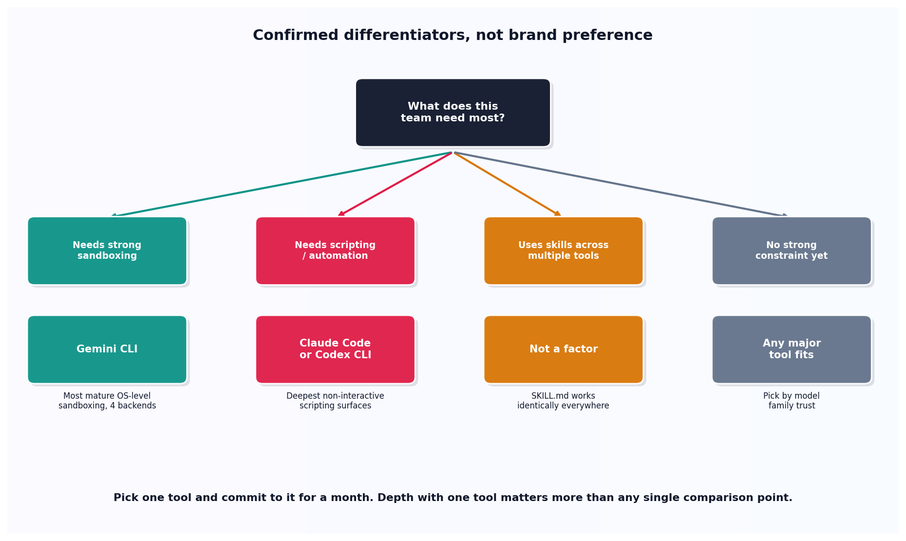

# Choosing a coding agent

## What the code showed you

Four scenarios routed through one decision function, grounded in confirmed current differentiators rather than brand preference. A team needing strong sandboxing got pointed to Gemini CLI specifically. A team already maintaining skills across several tools got told, correctly, that this isn't a real reason to prefer one tool over another anymore.

## What's actually happening underneath that

Confirmed from a current Q2 2026 comparison of terminal-based coding agents: Claude Code and Codex CLI have the deepest non-interactive and scripting surfaces of the major tools, genuinely useful for unattended automation. Gemini CLI has the most mature OS-level sandboxing, with four backend options, a real edge for teams wary of letting an agent run unsupervised shell commands. These are confirmed, specific differences, not vague brand impressions.

The scenario most people get wrong is the fourth one, and this topic's code deliberately includes it to make the point directly rather than leaving it implicit: skill portability used to be a real reason to standardize on one tool, back when Claude Code used CLAUDE.md and Codex CLI used AGENTS.md with no overlap. As of the 2026 SKILL.md standard, a skill written once works unchanged across all of them, which means a team already maintaining a skill library gains nothing from picking a tool on that basis specifically. Treating that as a non-factor, rather than inventing a reason to prefer one tool, is the more honest answer.

## Resources, in the order I'd actually use them

**For the comparison data this topic's defaults are grounded in**
- A current Q2 2026 comparison of six terminal-based coding agents (Claude Code, Copilot CLI, Gemini CLI, Codex CLI, Kiro, OpenCode) is the source of the scripting-depth and sandboxing-maturity claims used directly in this topic's decision function.

## The one thing worth remembering

This project's own main roadmap gives the advice that matters more than any single comparison point: pick one tool and commit to it for a month, learning its harness deeply, rather than tool-hopping based on whichever comparison post happens to be newest. The differentiators in this topic matter for the initial choice. Depth with one tool matters more after that.
