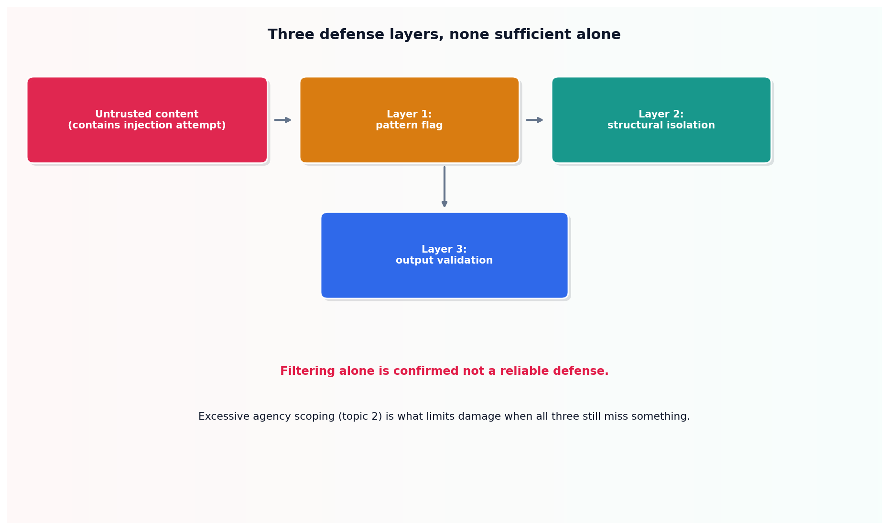

# Prompt injection defense

## What the code showed you

A single realistic piece of untrusted content, the kind an agent might read from a support ticket, containing the single most well-documented injection pattern across every current security source. A pattern flag caught it. Structural isolation wrapped it regardless. Output validation correctly told apart a genuinely relevant response from a hijacked one that abandoned the actual task.

## What's actually happening underneath that

Prompt injection is confirmed as LLM01:2026, the top-ranked risk in OWASP's current Top 10 for LLM Applications, in every edition of this list since it began in 2023. The core problem: an agent that reads untrusted content, a webpage, an email, a document, can have its actual instructions hijacked by text embedded in that content, text the application never intended as a command.

Three layers, each catching something different. A pattern flag catches known phrasings, cheap and fast, but blind to any rewording. Structural isolation, wrapping untrusted content in clear delimiters and explicitly instructing the model to treat it as data only, helps regardless of exact wording, since it gives the model a structural signal rather than relying on recognizing a specific phrase. Output validation catches what the first two missed, by checking after the fact whether the response still relates to the actual task.

Confirmed directly from OWASP's own current guidance: filtering alone is not a reliable defense against this risk. None of these three layers, including all three combined, eliminates the risk entirely. That's not a failure of this topic's code, it's the honest state of the problem, which is exactly why the next topic, excessive agency, matters as much as detection does.

## Resources, in the order I'd actually use them

**For the current, authoritative ranking and definition**
- OWASP's Top 10 for LLM Applications, 2026 edition, published August 2026, the third release since 2023, names Prompt Injection as LLM01, its top-ranked risk, unchanged in rank across every edition.

## The one thing worth remembering

A defense that catches a known attack phrasing teaches an attacker to rephrase, not to stop. The real value of these layers isn't guaranteed prevention, it's making an attack more expensive and visible, while excessive agency scoping limits what succeeds anyway.
