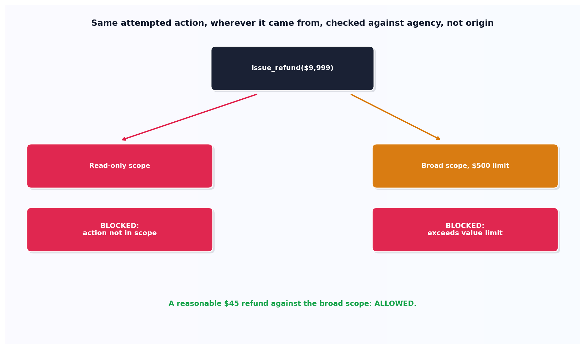

# Excessive agency

## What the code showed you

The identical attempted action, a $9,999 refund, checked against two different agency scopes. A read-only scope blocked it because the action itself was never permitted. A broader scope with a $500 per-action limit blocked the same action for a different, independent reason: the value exceeded what any single action in that scope is allowed to do. A reasonable $45 refund against the same broad scope was correctly allowed.

## What's actually happening underneath that

Excessive agency is confirmed as LLM03:2026 in OWASP's current Top 10, and its single biggest promotion in the 2026 rewrite. The 2025 list treated agency as a downstream concern. The 2026 list treats it as the actual control deciding whether a successful prompt injection is a minor inconvenience or a real incident. The logic is direct: if an injection succeeds against an agent that can only read data, the damage is bounded. If the identical injection succeeds against an agent that can issue refunds or delete accounts, it is not.

The genuinely important design detail in this topic's code: the scope check never asks whether the instruction to take an action was legitimate or injected. It only checks what the action would do. This is deliberate, and it's what makes the control actually reliable, since a perfect way to tell legitimate instructions apart from injected ones doesn't exist, confirmed directly in this stage's previous topic. What does exist is a hard ceiling on consequences, enforced the same way regardless of where the instruction came from.

## Resources, in the order I'd actually use them

**For the current ranking and the reasoning behind the promotion**
- OWASP's 2026 Top 10 for LLM Applications documents this promotion directly, describing the shift from treating agency as downstream to treating it as the control that determines the actual severity of a successful injection.

**For how this connects to this project's earlier scoping work**
- This project's Stage 7 and Stage 13 both built related scoping mechanisms, for tool permissions and shell commands respectively. This topic applies the same underlying principle specifically to the risk OWASP currently ranks third overall.

## The one thing worth remembering

A perfect injection defense doesn't need to exist for a system to be safe. A hard ceiling on what any successful instruction, legitimate or injected, can actually do is a complete, independent safety property on its own.
