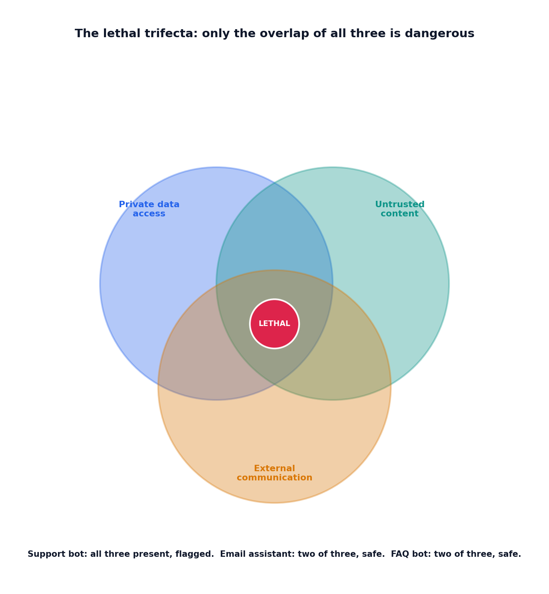

# The lethal trifecta

## What the code showed you

Four agent configurations checked against the same three capabilities. Only the customer support bot, with private data access, exposure to untrusted tickets, and the ability to send email, had all three at once, and it was the only one flagged. An email-drafting assistant with two of three capabilities, genuinely risky on its own, correctly came back as a safe combination, since without external communication an injection inside it has nowhere to send anything.

## What's actually happening underneath that

The lethal trifecta, named by Simon Willison and confirmed as directly tied to OWASP's current LLM Top 10 coverage, names the specific combination that makes an agent genuinely dangerous: private data access, exposure to untrusted content, and a way to communicate externally, all three present at once. Any two alone are manageable. All three together mean an injected instruction, hidden in content the agent reads, can direct it to exfiltrate private data through its own communication channel, with no human ever noticing the data left in the first place.

The practical value of checking for this combination directly, rather than only checking for injection attempts: it's a configuration-time check, not a runtime detection problem. An agent's capabilities are known in advance, before it ever processes a single real request, which means this check can run once, during design, and catch the risk before any attack is attempted at all.

## Resources, in the order I'd actually use them

**For the original framing**
- Simon Willison's writing on the lethal trifecta is the origin of this specific three-capability framing, and it's explicitly cited in current OWASP-adjacent security guidance as the reason filtering alone, this stage's topic 1, cannot be treated as a complete defense.

## The one thing worth remembering

The fix isn't perfecting the filter on untrusted content. It's removing one leg of the triangle. This topic's own closing note makes the specific, actionable version of that concrete: a support bot can keep its data access and its exposure to tickets if its ability to send email autonomously gets replaced with drafts a human reviews before sending, breaking the combination without removing the bot's actual job.
