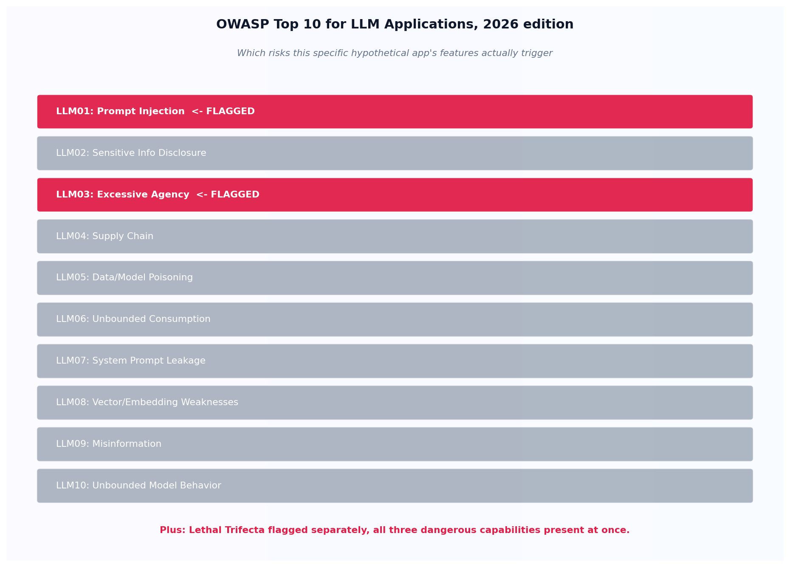

# The OWASP coverage audit

## What the code showed you

A single, realistic hypothetical application, a support bot reading tickets with CRM access and email-sending ability, audited against the full current OWASP list. Three findings came back: prompt injection, excessive agency, and the lethal trifecta, each one tied directly to a specific feature the app actually has, not to every risk on the list regardless of relevance.

## What's actually happening underneath that

OWASP published the 2026 edition of its Top 10 for LLM Applications on August 3-4, 2026, confirmed as the third release since the list began in 2023, this time built partly from contributed incident data rather than practitioner judgment alone. The ten risks, in rank order: Prompt Injection, Sensitive Information Disclosure, Excessive Agency, Supply Chain, Data and Model Poisoning, Unbounded Consumption, System Prompt Leakage, Vector and Embedding Weaknesses, Misinformation, and Unbounded Model Behavior.

The real value of an audit like this topic's code isn't reciting the list, it's connecting specific application features to specific risks, and specific risks to specific mitigations already built earlier in this stage. A support bot with CRM access, ticket reading, and email sending isn't an unusually dangerous design, it's an entirely ordinary feature set, and that's exactly the point: these risks live in normal applications doing normal things, not in some hypothetical edge case.

## Resources, in the order I'd actually use them

**For the full current list and what changed**
- OWASP's 2026 Top 10 for LLM Applications is the primary source for the current ranking used directly in this topic's code, including the companion Top 10 for Agentic Applications (covering autonomous multi-step risks like goal hijacking) and the narrower MCP Top 10 for the protocol layer specifically.

## The one thing worth remembering

A security checklist that gets applied uniformly to every application regardless of its actual features teaches teams to skim it once and move on. An audit tied to specific features, the way this topic's code works, is the version that actually catches something, because it only raises what a given application's own design genuinely exposes it to.
