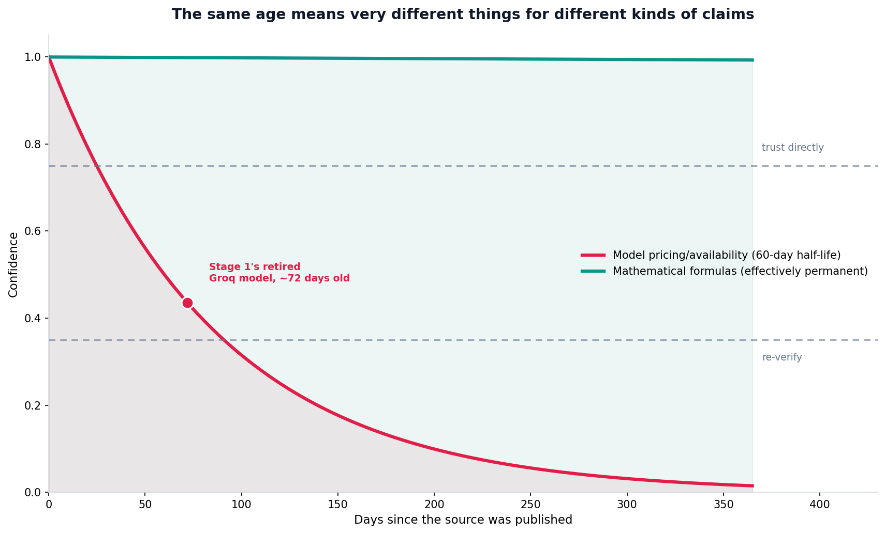

# Source currency scoring

## What the code showed you

The identical 72-day gap treated two completely different ways: a model pricing claim that old scored 0.435 confidence, worth spot-checking before relying on it, while a mathematical formula nearly four years old scored 0.967, trustworthy without a second look. Two numbers, same kind of calculation, opposite real-world meaning.

## What's actually happening underneath that

Every fact doesn't go stale at the same rate, and this project's own 14-stage build proved it directly, not hypothetically. Stage 1 hit a retired Groq model name live, a fact that had changed within about two months of being true. Stage 7's MCP research needed a full re-verification from scratch within the same build, because an earlier pass had only partially captured a protocol revision. Meanwhile Stage 2's gradient descent math and Stage 10's GRPO loss, both derived from calculus and optimization theory that hasn't changed in decades, needed zero re-checking regardless of how long ago any given explanation of them was written.

The scoring in this topic's code makes that distinction explicit instead of leaving it as an unstated gut feeling. A half-life model, the same mathematical idea used for radioactive decay, fits this surprisingly well: a volatile fact's trustworthiness drops by half every fixed number of days, while a stable fact's half-life is effectively infinite for any practical timeframe.

## Resources, in the order I'd actually use them

**For how this connects to this project's own build history**
- This project's own `stage-build-patterns.md` file, maintained across all 14 prior stages, is a direct record of exactly which categories of fact actually went stale during this build and which didn't, the same data this topic's volatility tiers are grounded in.

## The one thing worth remembering

Before trusting a source's age, ask what kind of fact it's making a claim about. The same six months means almost nothing for a mathematical proof and quite a lot for a provider's current model list, and conflating the two is how outdated information quietly survives into something that should have been re-checked.
