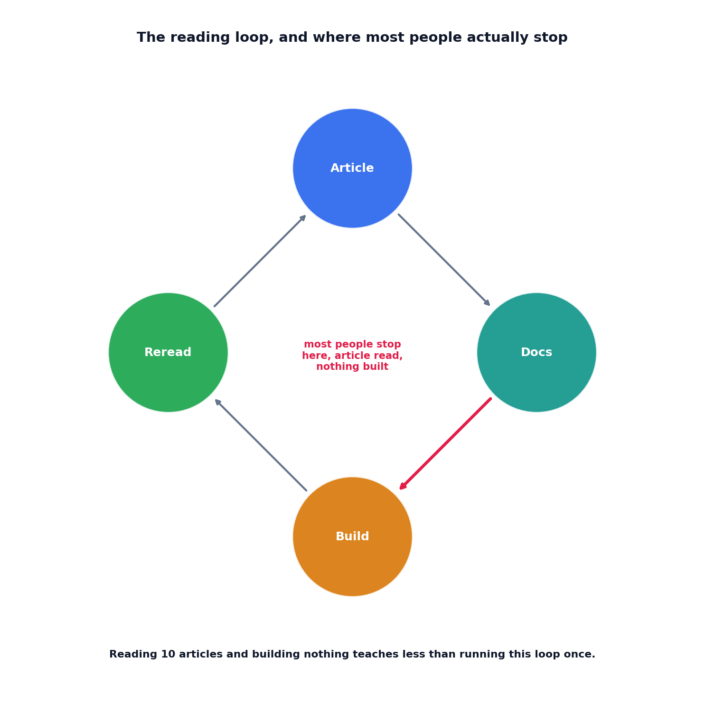

# The reading loop tracker

## What the code showed you

Four topics tracked through a real loop. One made it all the way through to reread. Two got stuck exactly where the real failure mode lives, article read, maybe docs too, nothing ever built. An attempt to skip straight from "article read" to "reread complete" was rejected outright, because rereading without having built anything first produces none of the benefit the loop exists for.

## What's actually happening underneath that

This project's own main roadmap names a specific loop as the one that actually compounds knowledge: one conceptual article, one official docs page, build a tiny version yourself, then reread the article once you have scars from building it. The explicit claim that loop makes, and this topic's tracker exists specifically to enforce: reading ten articles on one topic and building nothing teaches less than running this loop once, end to end.

The reason a tracker matters at all, rather than just knowing the loop exists: the specific failure mode is quiet, not dramatic. Nobody decides to stop after reading an article. They just don't get around to the build step, and the topic silently stays at "read about it" forever, feeling like it was learned when it wasn't. A tracker that explicitly surfaces "which topics are stuck before building" turns a vague feeling of having covered something into a checkable fact.

## Resources, in the order I'd actually use them

**For the original framing this topic builds on**
- This project's own main roadmap states the loop directly in its closing section on staying current, including the specific claim about ten articles versus one completed loop that this topic's tracker is built to hold accountable.

## The one thing worth remembering

A reading habit that only ever reaches the "article read" stage isn't a smaller version of the real loop, it's a different activity entirely, one that produces the feeling of learning without much of the substance. The build step is not optional polish on top of reading, it's the step the entire loop's value actually comes from.
