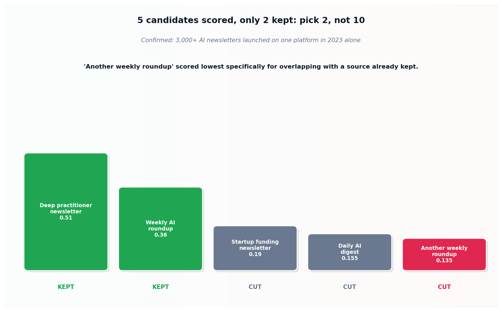

# Signal vs. noise curation

## What the code showed you

Five realistic newsletter candidates, scored and ranked. A deep practitioner source and a weekly roundup came out on top, genuinely complementary to each other. A second weekly roundup, consistent and reasonably deep in isolation, scored lowest of all five, not because it was a bad newsletter, but because it covered almost exactly the same ground as the first roundup already kept.

## What's actually happening underneath that

Confirmed directly for this build: more than 3,000 AI newsletters launched on a single platform in 2023 alone, and the number has kept climbing since. This project's own main roadmap gives deliberately narrow advice against that backdrop: pick two, not ten, one weekly roundup for breadth and one deeper practitioner source for depth, rather than subscribing broadly and reading nothing fully.

The scoring in this topic's code makes the actual discipline explicit rather than leaving it as "read good things." Consistency and depth are real positives. Overlap with sources already being read is a real negative, weighted directly into the score, because a third source covering the same model releases the first two already cover adds reading time without adding information. The right question was never "is this source good in isolation," it's "does this source add something the ones I already read don't."

## Resources, in the order I'd actually use them

**For the current landscape this topic's numbers are grounded in**
- Current 2026 rankings of AI newsletters confirm both the sheer volume problem (thousands of newsletters, most covering the same handful of weekly announcements) and the specific sources this project's main roadmap already recommends as genuinely complementary: a weekly roundup for breadth, a deeper practitioner newsletter like Interconnects for post-training specifics.

## The one thing worth remembering

Subscribing to more sources feels like doing more to stay current, and usually accomplishes less, once overlap is accounted for honestly. Two sources read completely beats ten sources skimmed, and the cut list in this topic's own output is the discipline that makes that trade actually happen instead of staying a nice idea.
