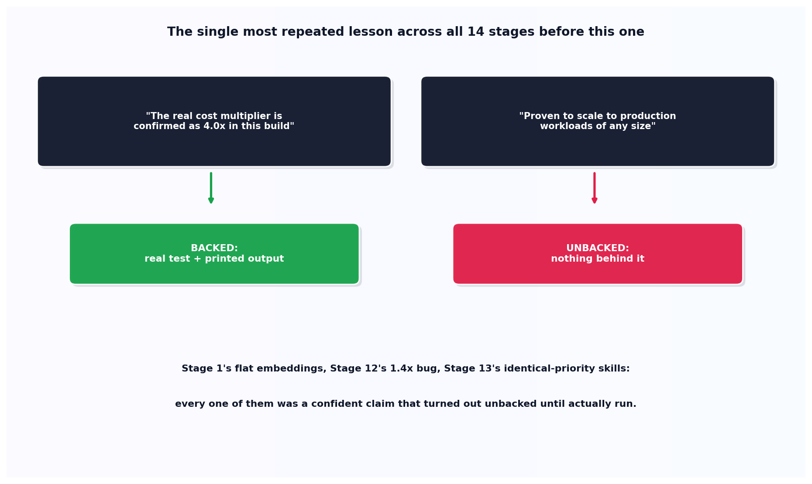

# Claims vs. verified

## What the code showed you

Two confident-sounding claims from a realistic docstring. "The real cost multiplier is confirmed as 4.0x" came back backed, a real test and a real printed output both support it directly. "Proven to scale to production workloads of any size" came back unbacked, nothing in the available evidence supports it at all, despite reading just as confidently as the first sentence.

## What's actually happening underneath that

This is the single most repeated lesson across every one of the 14 stages built before this one, confirmed by actually reviewing this project's own `stage-build-patterns.md` rather than relying on a vague memory of the build. Stage 1's attention diagram used random embeddings that produced a meaningless near-uniform result until hand-picked values proved the mechanism actually worked. Stage 12's self-host calculator computed a 1.4x multiplier while its own comments claimed the confirmed 3-5x figure, caught only by actually running the code and noticing the contradiction. Stage 13's skill-priority conflict wasn't a real conflict at all until two genuinely different priorities replaced two accidentally identical ones.

Every one of those was a confident, specific, reasonable-sounding claim that turned out to be unbacked the moment it was actually checked against the evidence. None of them were lies, exactly, they were assumptions written in the confident voice of a verified fact, which is precisely what makes this failure mode dangerous: it doesn't look like a guess, it reads like a finding.

## Resources, in the order I'd actually use them

**For the direct record of every instance this project caught**
- This project's own `stage-build-patterns.md` changelog is the primary source here, a dated, specific record of every one of these bugs, what caused each one, and how each was actually caught, not a reconstructed summary.

## The one thing worth remembering

The word "confirmed" in a sentence is not evidence that something was confirmed. This entire project, all 15 stages of it, ran on the discipline of asking what specifically backs a claim like that, and catching the moments it didn't, which turned out to be the single habit worth carrying forward past every individual technical lesson in between.
